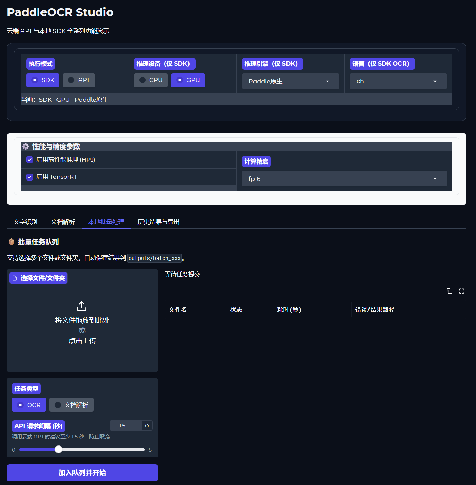

# PaddleOCR Studio 🚀
一个基于 Gradio 构建的 **PaddleOCR 全系列功能演示与批量处理工作站**。

本项目旨在为开发者、研究人员及测试人员提供一个高度集成、开箱即用的可视化操作界面。无需编写代码，即可轻松对比**云端 API** 与**本地 SDK** 的推理效果，并支持生产级的**批量自动化处理**与**结果持久化**。

> 📸 **界面预览**


---

## 📖 目录
- [PaddleOCR Studio 🚀](#paddleocr-studio-)
  - [📖 目录](#-目录)
  - [✨ 核心特性](#-核心特性)
  - [🛠️ 环境准备](#️-环境准备)
  - [🚀 快速开始](#-快速开始)
  - [💡 使用指南](#-使用指南)
  - [📂 项目结构](#-项目结构)
  - [⚠️ 免责声明与法律风险提示 (Disclaimer)](#️-免责声明与法律风险提示-disclaimer)
  - [🤝 贡献与致谢](#-贡献与致谢)
  - [📄 License](#-license)

---

## ✨ 核心特性

*   **☁️ 双端无缝切换**：一键切换云端 API 与本地 SDK 推理模式。
*   **⚙️ 多引擎多设备支持**：本地支持 PaddlePaddle 原生（含 HPI/TensorRT 加速）、ONNX Runtime、Transformers 三大推理引擎。**界面会根据所选引擎自动动态显隐相关性能参数**，避免无效配置。
*   **📄 全系列功能覆盖**：支持通用文字识别（PP-OCRv5/v6）、复杂文档解析（PP-StructureV3 / PaddleOCR-VL），自动提取高精度的结构化 Markdown 与 LaTeX 公式。
*   **🖼️ 多页可视化**：原生支持 PDF 多页解析，并通过 Gallery 组件直观展示每一页的版面分析渲染图（Layout Visualization）与 OCR 标注结果。
*   **📦 自动化批量处理**：支持多选文件/文件夹加入任务队列。内置**请求间隔控制**与**后端退避重试**机制，彻底杜绝云端 API 限流中断，结果自动打包落盘。
*   **📜 历史记录看板**：实时记录每次推理的详细配置（模型、引擎、设备），支持一键加载历史状态回显，支持按行多选或一键全量导出。
*   **🛡️ 健壮性设计**：
    *   API 触发限流时自动退避重试。
    *   本地缺失高性能依赖（如 `ultra-infer`）时自动降级。
    *   结果文件智能重命名，**坚决不覆盖已有数据**。
    *   自动拦截不支持的垃圾文件格式。
*   **💾 状态持久化**：所有 UI 参数（包括 Token、模型选择、推理设备等）自动持久化到本地 `config.json`，重启应用无缝恢复。

---

## 🛠️ 环境准备

建议使用 **Python 3.9+** 环境。

**1. 安装 Python 依赖**
```bash
pip install -r requirements.txt
```

**2. 安装 PaddlePaddle 框架**（⚠️ 请务必根据你的硬件环境二选一）

官方建议锁定 `3.2.0` 版本以保证与 PaddleOCR 3.7 的兼容性：

*   **CPU 环境**：
    ```bash
    pip install paddlepaddle==3.2.0
    ```
*   **NVIDIA GPU 环境 (以 CUDA 11.8 为例)**：
    ```bash
    pip install paddlepaddle-gpu==3.2.0 -i https://www.paddlepaddle.org.cn/packages/stable/cu118/
    ```

> **💡 Windows 用户避坑指南**：
> 如果在 Windows 下遇到 `cudnn_cnn64_9.dll` 加载失败报错，请确保你安装的是 `paddlepaddle-gpu`，并在 `backends/sdk_backend.py` 文件顶部，将 cuDNN 的绝对路径加入环境变量：
> ```python
> import os
> cudnn_path = r"C:\Your\Conda\env\Lib\site-packages\nvidia\cudnn\bin"
> if os.path.exists(cudnn_path):
>     os.add_dll_directory(cudnn_path)
> ```

---

## 🚀 快速开始

1. 克隆本项目并进入目录：
```bash
git clone https://github.com/GongHuilin-DL/paddleocr-studio.git
cd paddleocr-studio
```

2. 启动应用：
```bash
python app.py
```

3. 在浏览器中打开 `http://127.0.0.1:7860`。

---

## 💡 使用指南

*   **API 模式**：在顶部输入框填入你的百度 AI Studio Access Token（或提前设置环境变量 `PADDLEOCR_ACCESS_TOKEN`）。
*   **本地 SDK**：选择推理设备和引擎。若勾选了“启用高性能推理 (HPI)”但本地未安装相关依赖，系统会自动降级为标准推理并在界面给出黄色提示。
*   **批量处理**：切换至“本地批量处理”页签，一次性选择多个文件。**强烈建议在 API 模式下将“请求间隔”设置为 `1.5s` 以上**，以保护你的账号并发额度。
*   **历史与导出**：在“历史结果与导出”页签，点击表格中的任意行，即可在右侧加载该次结果或进行多选/全选打包下载。

---

## 📂 项目结构

```text
paddleocr-studio/
├── app.py                  # Gradio 界面入口与事件绑定 (核心UI逻辑)
├── requirements.txt        # 基础 Python 依赖
├── config.json             # (自动生成) UI 状态持久化配置
├── outputs/                # (自动生成) 所有的结果图片、JSON、ZIP 压缩包
├── backends/               # 后端适配器层
│   ├── base.py             # 统一的数据输入输出接口定义
│   ├── api_backend.py      # 云端 API 调用与解析
│   └── sdk_backend.py      # 本地 SDK 调用与引擎封装
├── services/               
│   └── runner.py           # 核心路由，根据 UI 参数选择不同的后端
└── adapters/               
    └── result_normalizer.py# 统一数据结构 (可选)
```

---

## ⚠️ 免责声明与法律风险提示 (Disclaimer)

1. **仅供学习与测试**：本项目为个人开发的开源演示程序，主要用于技术研究与测试，**严禁用于任何违反当地法律法规、侵犯他人隐私或从事非法商业牟利的场景**。
2. **API 计费与合规**：调用云端 API 时，请务必遵守百度智能云/飞桨 AI Studio 的相关服务条款。本项目内嵌的重试机制仅用于缓解网络抖动，请勿恶意高频请求或用于爬虫等滥用行为。因违规调用导致账号被封禁，本项目不承担任何责任。
3. **数据安全**：本系统在运行过程中会将解析结果（JSON、图片等）保存在本地 `outputs/` 目录下。请确保你上传的文档不包含涉密或敏感信息。开发者对由于数据泄漏造成的损失不承担责任。
4. **版权与商标**：PaddleOCR、PaddlePaddle 相关版权归百度公司所有。本项目仅为基于官方开源 SDK 和 API 构建的上层 UI 封装，遵循相应的开源许可协议（如 Apache-2.0）。用户在使用本工具生成的内容时，应当确保拥有原文档的处理权限。

---

## 🤝 贡献与致谢

欢迎提交 Issue 和 Pull Request！

特别感谢 [PaddleOCR](https://github.com/PaddlePaddle/PaddleOCR) 团队提供的强大底层能力，以及 [Gradio](https://github.com/gradio-app/gradio) 提供的优雅 Web UI 框架。

## 📄 License

本项目基于 [Apache License 2.0](https://www.apache.org/licenses/LICENSE-2.0) 开源。
